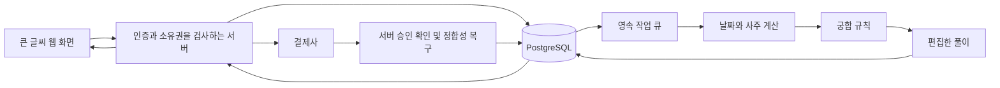

# 기술 구조와 개발 환경

2026-10-14 구현 상태: [서버 연결 앱](../web/README.md)과 [완료/미완료 대조](server-app-status.md)를 먼저 확인한다. 아래 상세 설계에는 운영 전 예정 항목도 포함된다.

## 제안 구성

| 영역 | 제안 | 이유와 상태 |
|---|---|---|
| 웹 앱 | Next.js + TypeScript | 화면과 서버 API를 한 프로젝트에서 관리, 버전은 설치 시 고정 |
| DB | PostgreSQL, 관리형 후보 Supabase | 관계·구매·권한을 트랜잭션으로 처리 |
| 인증 | Supabase Auth 후보 | 익명 시작과 영구 계정 연결 검증 필요 |
| 사주 엔진 | manseryeok 고정 원본 + 연구 어댑터 | 서버 연구 계산 연결, 운영 미승인 |
| 궁합 | 자체 순수 함수와 버전 규칙 | 같은 입력은 같은 판단 |
| 풀이 | 편집한 템플릿과 JSON 스키마 | AI 없이 시작, 검토 가능 |
| 결제 | Toss Payments 후보 | PG 가입·심사·실계약은 별도 |
| 지도 | 정해진 거리와 각도를 사용하는 화면 컴포넌트 | 힘 시뮬레이션 없이 위치 안정성 확보 |
| 작업 실행 | DB job + 서버 worker | 네트워크 단절과 재시도에도 결과 생성 보장 |
| 배포 | 미정 | 사용자 선호·예산·worker 실행 조건 확인 후 결정 |

관리형 DB를 써도 스키마·데이터·권한은 우리가 관리한다. 로컬 개발과 staging, production은 별도 DB·키를 사용한다. 이 문서 작성 중에는 어느 외부 프로젝트도 생성하지 않았다.

## 데이터 흐름



생일 입력 원문 → 정규화 → 개인 사주 → 두 사람 비교 → 풀이 → 저장된 결과로 단계별 타입을 분리한다. 계산 엔진 출력 JSON을 그대로 화면이나 공유로 보내지 않는다.

## 구현 폴더 계획

```text
src/app/                 화면과 서버 라우트
src/domain/birth/        날짜 검증과 정규화
src/domain/saju/         엔진 인터페이스 및 어댑터
src/domain/compatibility/고정 규칙과 근거
src/domain/readings/     문구 선택과 결과 스키마
src/domain/billing/      무료권·주문·이용권 상태
src/domain/sharing/      공개 필드와 토큰
src/server/db/           권한을 검사하는 DB 접근
src/server/jobs/         claim·lease·retry·복구
src/components/          큰 입력·버튼·결과·지도·목록
content/                 버전 관리하는 풀이 원본
db/migrations/           리뷰한 순차 SQL
tests/fixtures/          출처와 기대값이 있는 합성 사례
tests/e2e/               전체 흐름
```

위 폴더는 최초 예정 구조다. 실행 가능한 구현은 `web/`에 있으며 현재 JSONB 스냅샷 중심 구조와 운영 전 확장 항목은 구현 상태 문서에 대조했다.

## 경계와 의존성

- 화면 컴포넌트는 PG나 계산 라이브러리를 직접 호출하지 않는다.
- 엔진 교체 시 입력/출력 계약을 유지하고 engine_version을 변경한다.
- 결제 공급자 코드는 billing 어댑터 뒤에 둔다.
- DB 접근은 사용자 JWT 기반 RLS 또는 명시적으로 제한된 서버 경로를 사용한다. service role을 사용하면 RLS가 자동으로 지켜준다고 가정하지 않는다.
- 작업 큐는 주문/무료권 생성 트랜잭션과 함께 등록한다. 요청이 끝난 후의 임시 백그라운드 Promise에 의존하지 않는다.
- 네트워크를 기다리는 동안 DB 트랜잭션을 열어두지 않는다.
- 로컬에서 먼저 mock provider, 합성 사용자, 테스트 결제로 검증한다.

## 예상 비용을 계산하는 방법

월 비용 = 앱 호스팅 + DB/백업 + worker + 관측 도구 + 결제 수수료 + 선택한 인증 비용.

초기안은 사주 API 호출 비용과 LLM 토큰 비용이 없다. 자체 서버·유지보수·콘텐츠 감수 비용은 존재한다. 2,900원에서 PG 수수료·환불·세금·운영비를 제외한 손익은 계약과 실제 사용량 확인 후 계산한다. 현시점 임의 단가로 수익성을 보장하지 않는다.
