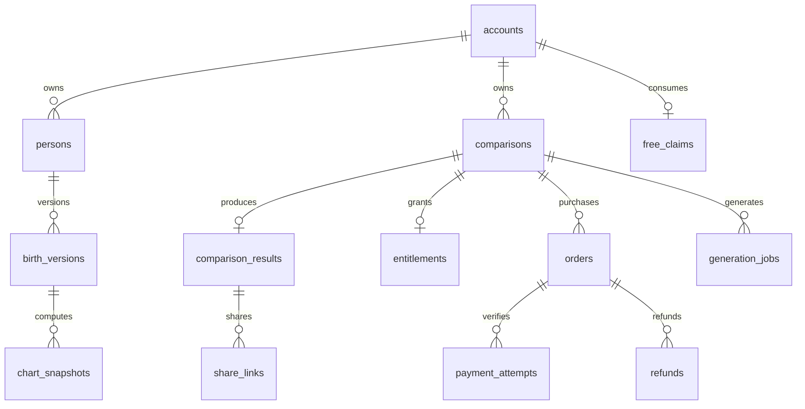

# 내부 데이터베이스 설계

## 선택과 범위

PostgreSQL을 기본안으로 한다. 초기 운영 후보는 Supabase이며 로컬 개발용 DB와 staging/production은 분리한다. 아래는 논리 설계로, 실행 가능한 SQL 마이그레이션은 P04에서 작성·테스트한다.

UUID 식별자, 시간은 `timestamptz`, 금액은 원 단위 정수, 생일은 날짜/시간 구성값으로 저장한다. 음력 생일을 양력 `date` 컬럼 하나에 잘못 넣지 않는다. 상태는 CHECK 또는 enum으로 허용값을 제한한다.

## 테이블과 주요 필드

| 테이블 | 핵심 필드 | 역할 |
|---|---|---|
| accounts | id, auth_user_id unique, kind(guest/member), status, created_at, guest_expires_at | 소유자와 인증 연결 |
| persons | id, owner_id, role(self/partner), nickname, relationship_type, archived_at | 내 프로필 및 상대 표시 정보 |
| birth_versions | id, owner_id, person_id, calendar_type, birth_year/month/day, is_leap, birth_time nullable, time_known, timezone_policy, normalized_solar_date, fingerprint, version_no | 변경 불가능한 출생 정보 버전 |
| chart_snapshots | id, owner_id, birth_version_id, engine_version, policy_version, chart_json, created_at | 개인 사주 계산 스냅샷 |
| rule_releases | id, version unique, rules_checksum, status, review_note, published_at | 궁합 규칙 release |
| template_releases | id, version unique, status, checksum, published_at | 풀이 문구 release |
| reading_templates | id, release_id, template_key, relation_type, title, body, condition_key | 승인된 문장 |
| comparisons | id, owner_id, self_birth_id, partner_birth_id, relationship_type, engine_version, rule_release_id, template_release_id, status, created_at | 비교 작업의 고정 입력 |
| comparison_results | id, owner_id, comparison_id unique, self_chart_id, partner_chart_id, score, distance_band, feature_json, reading_json, created_at | 완성 결과와 근거 |
| free_claims | owner_id unique, comparison_id nullable, state(available/reserved/consumed), reservation_generation, reserved_until, consumed_at | 첫 1명 무료 사용권 |
| orders | id, owner_id, comparison_id, merchant_order_id unique, amount_krw, currency, state, idempotency_key, expires_at | 유료 주문과 확정 가격 |
| payment_attempts | id, order_id, provider, provider_payment_key unique nullable, state, verified_amount, verified_at, error_code | 승인 시도 및 공급자 확인 |
| refunds | id, order_id, provider_refund_id unique nullable, state, amount_krw, idempotency_key, reason_code | 환불 상태와 복구 |
| entitlements | id, owner_id, comparison_id unique, source(free/paid), order_id nullable, state(active/revoked), created_at | 결과를 열람할 권리 |
| generation_jobs | id, owner_id, comparison_id, state, attempts, available_at, lease_until, fencing_token, last_error_code | 결과 생성 작업 |
| payment_events | id, provider, provider_event_key unique, order_id nullable, processing_state, received_at, processed_at, payload_redacted | 웹훅 중복 제거 및 재처리 |
| share_links | id, owner_id, result_id, token_hash unique, public_snapshot, expires_at, revoked_at | 최소 정보 공개 링크 |
| map_placements | owner_id, partner_person_id, preferred_angle, created_at | 안정적인 각도, 거리는 결과에서 계산 |
| consent_records | id, owner_id, scope, policy_version, accepted_at, withdrawn_at | 동의 기록 |
| audit_events | id, actor_id nullable, action, resource_type/id, created_at, metadata_redacted | 관리·환불·공유철회 추적 |

약 20개 테이블은 데이터 역할을 명확하게 나눈 설계다. P04에서 합쳐도 되지만 금전 기록·권한·결과 상태를 하나의 boolean으로 축소하지 않는다.

## 관계

comparisons는 두 개의 birth_versions를 참조한다. 둘 다 같은 owner_id에 속해야 한다. diagram에는 단순화를 위해 이중 출생 FK와 release 참조를 생략했으며 실제 마이그레이션에는 포함한다.

## 데이터 제약

- persons: owner별 active self 한 명만 허용하는 partial unique index.
- birth_versions: `(person_id, version_no)` unique. time_known=false면 birth_time은 null. 양력일 때 is_leap=false. 음력 유효성은 엔진 검증과 별도 제약으로 확인.
- 각 소유 데이터의 `(owner_id, id)`를 unique로 만들고 자식의 복합 FK가 같은 owner를 강제하게 한다. 다른 계정의 birth/result/order를 연결할 수 없게 한다.
- chart_snapshots: `(birth_version_id, engine_version, policy_version)` unique.
- comparisons: 같은 소유자·출생 버전 쌍·관계 맥락·release 조합에 중복 생성 방지 키. 사주 엔진 버전도 키에 포함.
- free_claims: owner당 하나. reserved 동안 다른 comparison으로 바꾸지 못하게 원자적으로 잠금.
- orders: `(owner_id, idempotency_key)` unique, amount_krw는 상품 가격 스냅샷, KRW 고정. 같은 comparison에 동시에 살아 있는 결제 주문 한 개를 partial unique로 제한.
- entitlements: comparison당 하나. free면 order_id null, paid면 owner와 comparison이 같은 검증 완료 주문 필요. 여러 테이블 상태 조건은 서버 트랜잭션/DB 함수로 강제.
- comparison_results.score: 결정된 점수 범위 CHECK. 최종 score 스케일 미결정이면 migration 전에 확정.
- generation_jobs: comparison당 active job 한 개. lease 회수마다 fencing_token 증가.
- share_links: 원문 토큰을 저장하지 않고 hash로 조회. 순번 ID를 공개 토큰으로 쓰지 않음.
- fingerprint는 생일만의 단순 해시가 아니라 서버 비밀키 기반 HMAC 및 key_version을 사용. 낮은 엔트로피 생일의 사전 대입을 어렵게 하되 해시를 익명화라고 부르지 않음.
- 다른 사람인데 생일이 같을 수 있으므로 fingerprint만으로 persons를 합치지 않음.

## 조회 인덱스

`persons(owner_id, archived_at)`, `comparisons(owner_id, created_at desc)`, `orders(owner_id, created_at desc)`, `generation_jobs(state, available_at)`, `share_links(token_hash)`, `payment_events(processing_state, received_at)`를 기본 검토한다. 실제 쿼리 EXPLAIN으로 추가/삭제한다.

## 인증과 소유권

Supabase Auth를 채택하면 accounts.auth_user_id가 인증 식별자와 연결된다. 화면에서는 가입 없이 시작하되 서버에서는 익명 인증 식별자를 만들어 데이터 소유권을 부여한다. 익명 사용자도 authenticated 역할을 가질 수 있으므로 ‘authenticated면 유료 구매 가능’으로 처리하지 않고 계정 상태를 확인한다.

- 사용자: 자기 데이터 SELECT, 허용된 별명·초안 변경만 제한된 API로 수행.
- 결제·무료권·결과·점수·이용권: 클라이언트 직접 INSERT/UPDATE 금지.
- worker: job과 계산/결과 기록에 필요한 최소 서버 권한.
- 공유 방문자: 원본 테이블 접근 없음. token을 검증한 서버가 public_snapshot만 반환.
- 운영자: 이유를 남기는 제한된 경로로 환불/지원. 모든 생일을 보는 범용 화면을 MVP에서 만들지 않음.

노출 스키마는 RLS와 grants를 함께 구성한다. 개인 데이터는 기본 거부, owner 기반 조회 허용. JWT에서 owner를 얻고 요청 body의 owner_id를 신뢰하지 않는다. service role은 서버에만 보관하고 사용하는 경로에는 별도 소유권 검사가 필요하다.

## 익명 계정 연결과 충돌

같은 익명 인증을 영구 계정에 연결하는 정상 경로에서는 accounts.id를 유지한다. 이미 가입한 계정으로 로그인하는 경우 두 인증을 모두 소유했음을 확인한 서버 이관 절차가 필요하다.

- 같은 내 출생 정보면 guest 상대/결과를 기존 계정으로 원자적으로 이관한다.
- 무료권은 둘 중 consumed가 있으면 consumed 유지. 두 무료 이력을 합쳐 추가 무료권을 만들지 않는다.
- 서로 다른 내 출생 정보면 자동으로 덮어쓰거나 다른 지도를 섞지 않는다. 기존 지도 유지/임시 체험으로 돌아가기를 안내하고 구매를 진행하기 전에 충돌을 해소한다.
- 모든 하위 owner FK 변경, entitlement, share 소유권은 한 이관 작업으로 처리하고 실패 시 롤백한다.
- 이관 실패를 이유로 원본 guest 결과를 즉시 삭제하지 않는다.

## 변경과 삭제

출생 정보 수정은 새 birth_version을 만든다. 기존 결제 결과는 당시 스냅샷을 유지한다. 별명만 바꾸면 계산하지 않는다. 내 생일을 수정하면 기존 지도는 이전 내 정보 기준이라는 안내가 필요하며 조용히 전원 재계산하지 않는다.

관계 유형을 친구에서 연인으로 바꾸는 경우 persons의 현재 분류만 수정한다. 기존 구매 결과의 relationship_type과 문구 스냅샷은 보존하며 이미 산 풀이를 조용히 다른 해석으로 덮어쓰지 않는다. 같은 출생 쌍의 관계별 문구 전환은 추가 과금하지 않는 방향으로 제안하고, 제공하려면 기존 entitlement를 확인하는 별도 무료 재구성 경로를 P05에서 정의한다. MVP 기본 화면은 구매 당시 관계 풀이를 보여준다.

지도에서 숨기기는 persons.archived_at로 처리하되 개인정보 삭제 요청과 구분한다. 삭제 요청은 관련 공유 링크부터 철회하고 원문·계산·공개 스냅샷을 정책에 따라 제거한다. 결제 기록은 별도 보존 요건을 확인한 후 식별정보를 최소화하여 유지한다. `ON DELETE CASCADE`로 금전 기록까지 지우지 않는다.

guest 초안/결과 보관은 초기 제안 30일이며 운영 정책 확정과 고지가 필요하다. 데이터 삭제·백업 만료·법정 보존 기간은 출시 전에 운영주체의 정책 검토로 확정한다.

## 마이그레이션 순서

M001 계정/사람/출생 버전 → M002 계산/release/풀이 → M003 비교/결과/무료권/작업 → M004 주문/승인/환불/이용권 → M005 공유/지도/동의/감사 → M006 RLS·grants·필요 함수 및 인덱스.

개발 환경에 전체를 적용하고 교차 계정 접근 테스트가 통과하기 전 외부 접근을 열지 않는다. clean install, 이전 migration에서 업그레이드, 실패 시 복구를 각각 검증한다.

## 표시용 캐릭터 확장안

persons에 `display_avatar_key`, `display_avatar_variant`, `avatar_catalog_version`을 저장하는 논리 설계를 추가한다. 서버가 승인한 카탈로그 키만 허용하고 임의 이미지 URL이나 SVG 문자열을 받지 않는다. 첫 생성 때 배정한 표시값을 저장하며 생일 해시·성별·오행으로 결정하지 않는다. 표시값 변경은 계산·이용권·과금에 영향을 주지 않는다.

share_links.public_snapshot에 공유 당시 두 사람의 표시 키·변형·카탈로그 버전을 복사한다. 이후 프로필 변경이 기존 공유를 바꾸지 않게 하고 구버전 자산과 기본 캐릭터 fallback을 준비한다. 소유권·철회·만료 정책은 기존 공유 규칙을 따른다. 상세는 [캐릭터 적용 설계](13-character-plan.md)이며 SQL·DB 적용은 P04/P06의 미완료 작업이다.
