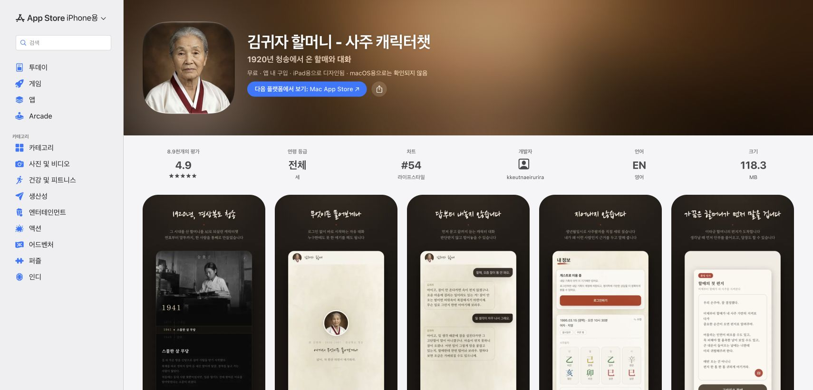

# 김귀자 할머니 공개 화면 확인과 조선 콘셉트 적용

2026-10-20. 사용자가 실제 예시 앱을 확인해 비슷한 디자인 분위기를 잡도록 요청했다. Chrome/CUA로 [공식 App Store 페이지](https://apps.apple.com/kr/app/id6761322235)와 해당 페이지가 연결한 [개발자 웹 서비스](https://guija.irurira.co/)를 직접 열었다. **앱 내부 화면은 개발자가 공개한 스크린샷 5장으로 확인했으며, 설치된 iOS 앱의 대화·결제·기억 동작을 실행한 것은 아니다.** 웹 서비스와 네이티브 앱도 같은 흐름이라고 가정하지 않는다.

이 Mac의 일반 앱 폴더에서 설치본을 찾지 못했다. 앱 설치·로그인·구독·결제는 실행하지 않았다. 공개 웹에서는 소개→안내→생일 입력까지 이동했고 개인정보나 가상 생일을 전송하지 않았다.

## 확인 순서와 상태

| 단계 | 확인 대상 | 상태·관찰 | 근거 |
|---|---|---|---|
| 1 | 실제 스토어 페이지 | 정상 표시. 공식 앱 제목과 5개 미리보기 확인 | [스토어 캡처](../reference/guija-2026-10-20/app-store.png) |
| 2 | 앱 소개 화면 | 공개 이미지 검토. 짙은 갈색·검정 바탕, 흑백 장면과 연표 | [소개 미리보기](../reference/guija-2026-10-20/01-store-intro.webp) |
| 3 | 앱 첫 대화 상태 | 공개 이미지 검토. 옅은 한지색, 작은 인물, 넓은 여백 | [첫 상태](../reference/guija-2026-10-20/02-store-empty-state.webp) |
| 4 | 앱 대화 화면 | 공개 이미지 검토. 먹갈색 사용자 말풍선, 밝은 답변, 붉은 전송 포인트 | [대화 미리보기](../reference/guija-2026-10-20/03-store-conversation.webp) |
| 5 | 앱 프로필 화면 | 공개 이미지 검토. 밝은 면과 붉은 주 행동, 기둥별 묶음 | [프로필 미리보기](../reference/guija-2026-10-20/04-store-profile.webp) |
| 6 | 앱 편지 화면 | 공개 이미지 검토. 종이 편지 형식, 붉은 인장, 갈색 확인 행동 | [편지 미리보기](../reference/guija-2026-10-20/05-store-letter.webp) |
| 7 | 실제 개발자 웹 시작 | 정상 표시. 밝은 배경에서 인물별 진입 제공 | [웹 시작](../reference/guija-2026-10-20/06-developer-home.png) |
| 8 | 실제 웹 소개 | 정상 이동. 검은 바탕, 인물·설명·진입 버튼. 390px로 확인 | [웹 소개](../reference/guija-2026-10-20/07-live-story-390.png) |
| 9 | 실제 웹 안내·입력 | 정상 이동. 안내 확인 후 성별·관계·달력·생일·시간 입력 노출. 제출/결제는 미실행 | [안내](../reference/guija-2026-10-20/08-live-notice-390.png), [입력](../reference/guija-2026-10-20/09-live-input-390.png) |

공개 미리보기의 [원본 URL·체크섬](../reference/guija-2026-10-20/sources.json)을 남겼다. 스토어 DOM에 실제 노출된 이미지 주소로 원본을 확보해 각각 열어 보았다. 실제 웹 캡처도 저장한 파일을 다시 확인했다. 모든 참고 캡처는 연구용이며 제품 자산으로 사용하지 않는다.

## 디자인에서 취할 점

- 사진과 인물의 배경이 먼저 분위기를 만든다. 과장된 장식보다 오래된 기록·작은 인물·여백이 중심이다.
- 소개는 어둡고, 읽고 입력하는 면은 옅은 한지색으로 구분된다. 갈색 본문과 붉은 인장 포인트가 반복된다.
- 제목은 손맛이 있는 글자, 본문은 차분한 명조 인상이다. 정확한 네이티브 폰트명·크기·색상값을 추출했다고 주장하지 않는다.
- 상대에게 말을 건네는 어조와 편지 형식을 참고하되 이름·전기·사투리·사진·문장을 복제하지 않는다.

## 접근성과 확인 한계

공개 앱 이미지의 작은 회색 보조 문구와 실제 웹의 어두운 본문/선택 상태는 읽기 어려울 위험이 보인다. 대비 수치 측정이나 네이티브 스크린리더·키보드 검사를 완료한 것은 아니다. 새 구현에서는 본문 18~20px, 명확한 선택 상태·레이블, 충분한 대비와 키보드/확대 검증을 유지한다. 프로필의 기둥 표시 역시 출처 앱의 계산 정확도 증거가 아니다.

## 우리 서비스에 반영한 시안

사용자의 추가 지시대로 **카메라를 보지 않고 책을 내려다보는 조선 남성 노인**을 새로 생성했다. 방과 책상을 함께 담는 거리, 흐린 단색 인화, 불균일한 자연광을 사용했다. 실제 역사 사진·실존 인물·선교사의 촬영물로 표시하지 않는다.

[새 시작 화면 3안](../design/characters/joseon/documentary-ui-v2/README.md)은 위 실제 공개 이미지와 새 가상 인물 사진을 생성 호출에 첨부해 만들었다. 초기 정면 초상 중심 3안보다 담백한 기록·한지·편지 방향으로 수정했다. 색/서체/인물 비율의 방향 시안이며 앱 적용·접근성 검사 완료가 아니다.

기존 두 사람 생일 입력→기호 설명→공유/보관 흐름을 유지한다. 자유 대화·기억·편지 알림·구독 등 참고 앱 기능은 이번 디자인 요청만으로 추가하지 않는다. 계산·풀이 승인·기존 저장 결과·가격·공유 카탈로그도 변경하지 않았다. 다음은 새 세 시안 중 선택한 안을 실제 화면에 적용하는 단계다.
