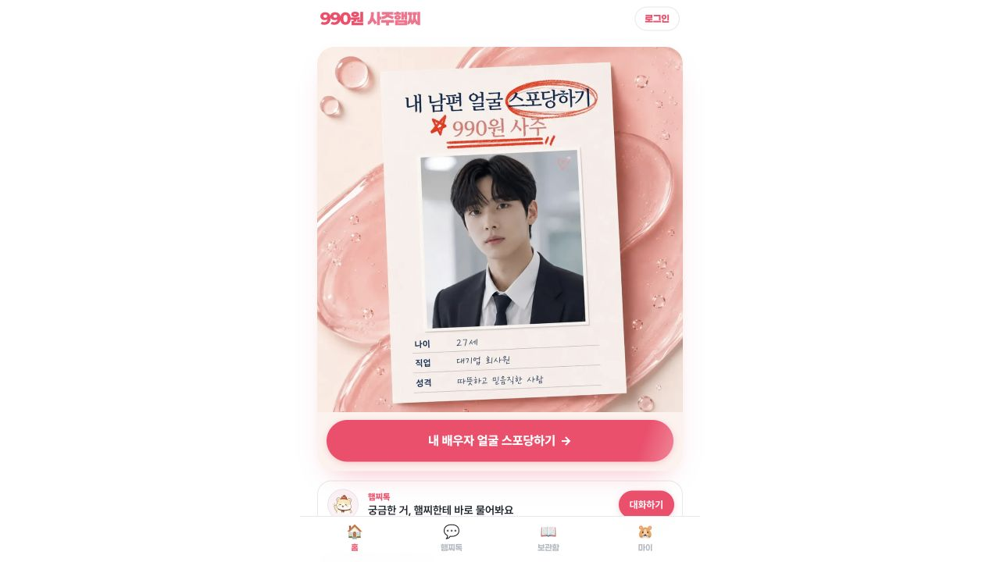
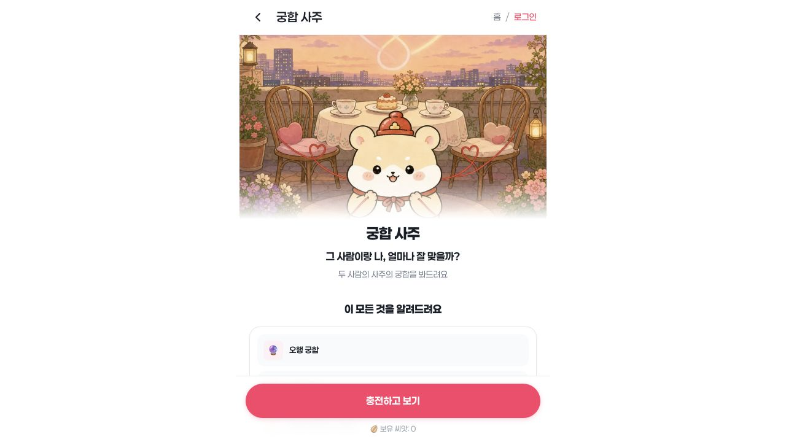
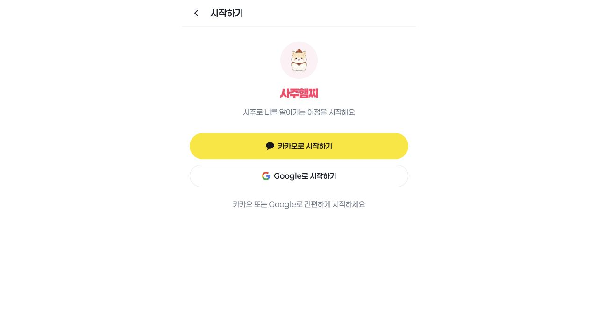

# 사주햄찌 공개 흐름 분석과 P02 적용안

확인일: 2026-10-12. Codex 인앱 브라우저에서 https://sajuham.app/ko 방문. 현재 공개 화면과 접근성 트리를 기준으로 확인했다. 로그인, 생일 입력, 충전, 결과 생성은 수행하지 않았다.

## 확인한 3단계

1. 홈 — 탐색 기능은 풍부하나 궁합까지 선택이 필요하다. 첫 화면은 배우자 얼굴 홍보 이미지와 CTA, 햄찌톡, 하단 4개 메뉴다. 접근성 트리에는 연애·타로·개인·타이밍·가족 카테고리와 전체 26개 리딩이 노출된다. 방문 목적이 궁합이라면 탐색 부담이 생길 가능성이 있다. 실제 이탈률은 확인하지 않았다.

2. 궁합 상품 상세 — 일러스트와 설명의 역할이 명확하다. 찻자리 배경의 햄스터가 친근함을 만들고, 굵은 제목과 분홍색 하단 CTA가 시선을 모은다. 오행·종합 점수·갈등 해결 등 제공 항목을 안내한다. 화면의 CTA는 ‘충전하고 보기’, 보유 씨앗은 0이다. 본문에는 990원 설명이 있으나 첫 viewport에는 원화 가격 대신 씨앗 잔액이 보인다. FAQ를 펼치면 시간 없이 년월일만으로 핵심 분석이 가능하다고 안내한다. 이는 사이트의 설명이며 계산 정확도를 검증한 사실이 아니다.

3. 충전 CTA → 로그인 — 카카오/Google 두 선택으로 화면은 단순하다. 생일 입력이나 결과 예시를 체험하기 전에 계정 단계가 나타났다. redirect에는 궁합 상품 경로가 보이지만 로그인 이후 복귀 동작은 미검증이다.

## 공개 화면에서 읽히는 전략

관찰: 990원이라는 진입 가격, 씨앗 1개 단위 상품, 다양한 고민별 리딩, 반복되는 햄찌톡 진입, 여러 화면의 동일 캐릭터가 있다.

해석: 저가의 여러 주제로 반복 이용을 유도하고 캐릭터를 상담 상대처럼 느끼게 하는 구성으로 보인다. 매출·전환율·재방문 효과는 자료가 없어 판단할 수 없다. 캐릭터 일관성은 참고할 만하지만 우리 MVP의 상품 몰·포인트·챗봇 제외 결정을 바꾸지 않는다.

## 접근성 관찰과 한계

제목과 주 행동은 시각적으로 구분된다. FAQ는 접근성 트리에 펼침/접힘 상태가 나온다. 반면 회색 보조 문구와 작은 하단 메뉴는 큰 글씨를 원하는 사용자에게 가독성 위험이 있다. 색상 대비 수치, 키보드 포커스 순서, 스크린리더 사용성, 모바일 실제 기기, 확대 시 재배치는 별도 측정하지 않았다. 접근성 적합 여부를 단정하지 않는다.

## 우리 제품에 적용할 P02 기준

- 첫 화면은 ‘첫 상대 한 명 무료로 보기’라는 한 가지 주 행동. 상품 목록과 씨앗 환산 없이 이후 추가 상대 1명 2,900원을 원화로 안내한다.
- 내 정보 → 상대 정보 → 결과·공유 → 결과 아래 지도 → 한 명 추가의 기존 흐름을 유지한다. 저장·구매 시 계정 연결 원칙도 유지한다.
- 캐릭터는 입력 안내, 기다림, 결과 요약, 지도 빈 상태를 연결한다. 제목·본문·버튼의 공간을 침범하지 않는다. 본문 18~20px와 큰 버튼을 우선한다.
- 햄스터·의상·색상 조합·씨앗·장면·문구를 복제하지 않는다. 새 캐릭터 방향으로 둥근 새 두 마리의 ‘인연 우체부’, 작은 구름의 ‘마음 날씨 안내자’, 수달의 ‘관계 정원사’를 후보로 제안한다. 모두 미선택이며 이미지 시안 검토 전 확정하지 않는다.
- 지도 거리는 검증된 궁합 규칙의 시각화이며 실제 친밀도를 뜻하지 않는다고 안내한다. 낮은 점수에도 관계를 단정하거나 이별을 권하는 문구를 쓰지 않는다.
- 시간 모름은 명시적 선택으로 제공한다. 절입 당일 연월주 불확실성과 과거 시간대 문제를 엔진 단계에서 해결하고 화면에 필요한 불확실성을 보존한다.

## 다음 작업

독창적 캐릭터 화면 시안 3개를 작성해 선택을 받은 후 P03 앱 골격으로 진행한다. P01은 독립 자료와 역사적 시간 경계 검증이 남아 있다. 이번 공개 흐름 분석은 엔진 검증이나 유료 결과 품질 평가의 완료 근거가 아니다.
